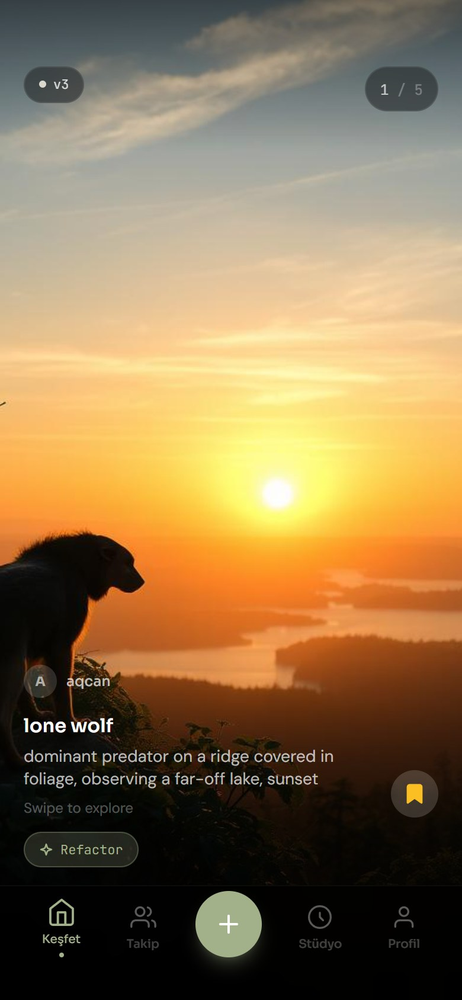
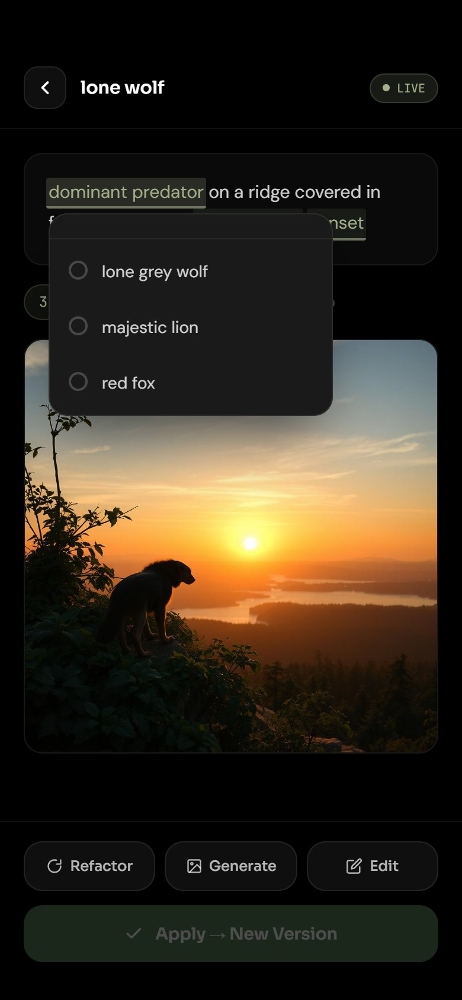

## Hi, I'm Sinan 👋

Junior full-stack developer and Software Engineering graduate (June 2026) from **Manisa Celal Bayar University**. I build web apps end to end with React, TypeScript, Node.js and PostgreSQL. Below are my personal and university projects.

🌐 [sinanakcan.com](https://sinanakcan.com) · 💼 [LinkedIn](https://www.linkedin.com/in/sinanakcan) · ✉️ sinanakcan2002@hotmail.com

### 🚀 Featured project

<table>
<tr>
<td width="55%" valign="top">
<h4><a href="https://github.com/aqcan/prompterest-neon">Prompterest</a></h4>
A prompt gallery for AI image generation that runs on the web and on Android. Browse prompts in a vertical feed, use an LLM to rewrite parts of a prompt (OpenRouter with a Hugging Face fallback), generate images with FLUX.1 and keep every change as a version. Built during my internship at Aslan Consulting (2026).  
The JWT-secured REST API runs in Docker behind Nginx. AI keys stay on the server, and the API has scrypt password hashing, ownership checks and rate limiting.  
<b>React · TypeScript · Capacitor · Hono · Drizzle · PostgreSQL (Neon) · Docker · Vitest</b>
</td>
<td width="45%" valign="top">

</td>
</tr>
</table>

### 🧰 Small tools

<table>
<tr>
<td valign="top">
<h4><a href="https://github.com/aqcan/aqcancast">aqcancast</a></h4>
My PC only has headphones, so I wrote this to stream its system audio to my phone's speaker over the home network. The browser captures the audio, a Node.js WebSocket relay forwards it as raw 24-bit PCM, and the phone plays it through a jitter buffer with packet-loss recovery. 
<b>Node.js · Express · WebSocket · Web Audio API</b>
</td>
</tr>
</table>

### 🎓 University projects

<table>
<tr>
<td width="50%" valign="top">

<h4><a href="https://github.com/aqcan/Tarzan-BitirmeTezi">Tarzan – 2D Platformer</a></h4>
Graduation thesis (2025). A 2D platformer with patrolling enemies, coin collection and a parallax background. Playable Windows build available. 
<b>Unity · C#</b>
</td>
<td width="50%" valign="top">

<h4><a href="https://github.com/aqcan/chatbot-proje">DestekChatBot</a></h4>
Cloud Computing course (2025). A demo store page with an embedded Dialogflow customer-support chatbot. 
<b>Google Dialogflow · HTML · CSS</b>
</td>
</tr>
<tr>
<td width="50%" valign="top">
<h4><a href="https://github.com/aqcan/yazilimYapimi-Odev">Vocabulary Trainer</a></h4>
Software Construction course (2024). An English–Turkish word trainer using a 6-repetition learning rule, with an exam mode and Word exam reports. 
<b>Python · python-docx</b>
</td>
<td width="50%" valign="top">
<h4><a href="https://github.com/aqcan/TurgutluKasapOtomasyon">Turgutlu Kasap Automation</a></h4>
Object-Oriented Programming course, team project (2021). Butcher shop automation with customer orders, payments and an admin panel. 
<b>C# · Windows Forms · SQL Server</b>
</td>
</tr>
</table>

### 🛠️ Technologies

🇹🇷 Manisa Celal Bayar Üniversitesi Yazılım Mühendisliği mezunuyum (Haziran 2026), junior full-stack geliştiriciyim. Burada kişisel projelerim ve okul projelerim yer alıyor.
